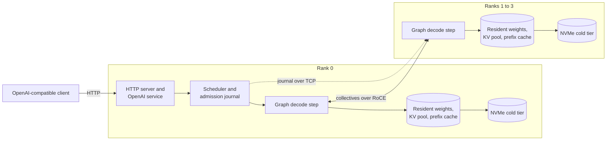

# DGPP

[](https://github.com/HawkBearPig/dgpp/actions/workflows/ci.yml)
[](https://github.com/HawkBearPig/dgpp/actions/workflows/gb10-build.yml)
[](LICENSE)
[](https://github.com/HawkBearPig/dgpp/releases/latest)
[](#getting-started)
[](https://huggingface.co/HawkBearPig)

DGPP is a C++ and CUDA inference engine for NVIDIA DGX Spark (GB10)
systems. It serves large mixture-of-experts and dense language models
through an OpenAI-compatible HTTP API on one Spark, or on two or four
Sparks joined by tensor parallelism over RoCE. The repository holds the
whole stack: CUDA kernels, RDMA collectives, tokenizer, Jinja
chat-template interpreter, scheduler, prefix cache, HTTP service, the
cluster launcher and the deployment templates.

## Why DGPP

- **Built for the Spark.** The GB10's 128 GB of unified memory, its
  tensor cores and its single 200 Gb RoCE port shape every design
  decision: the memory plan, the kernels, the collectives and the NVMe
  tier are written for this box rather than adapted to it.
- **Scales across Sparks.** Two or four nodes serve one model through
  tensor parallelism over RoCE, with the collectives captured inside the
  decode graph. The ranks behave as one machine: rank 0 journals every
  admission, every peer replays the same schedule and checks a digest of
  its operation stream each tick.
- **Serves checkpoints as published.** FP8, NVFP4, MXFP4, MXFP8, packed
  int4 and int8, GPTQ codebooks, AutoRound and EXL3 trellis weights are
  read by kernels written for each format. There is no conversion step
  and no dequantized copy, and BF16 tensors are kept in a lossless 12-bit
  form that rebuilds the exact bits in registers.
- **Exact.** The default chain computes what the checkpoint specifies. A
  greedy request returns the same tokens run after run, on every rank,
  with speculative decoding on or off. Reduced-precision levers are
  explicit keys, off by default and named in the startup log.
- **Fast where it counts.** Graph decode, speculative decoding with MTP
  layers, DeepSeek's DSpark blocks or the DFlash2 drafter, continuous
  batching with latency-adaptive prefill, exact prefix caching with an
  NVMe cold tier, KV pools up to 2M tokens and YaRN ramps to 768K
  positions.
- **Complete and operable.** The OpenAI Chat Completions surface with
  tools, structured output, reasoning, logprobs, images and PDF files.
  Metrics as JSON and Prometheus. A setup wizard, a cluster launcher,
  versioned releases, a startup memory plan and fast boot from a resident
  image cache. No Python at serving time.

## Performance

Decode throughput counts the engine's decode steps only. Cold prefill is
the median of three uncached prompts at each length. Ranges span five
prompt classes, and C is the number of concurrent client requests.

| Model / weights | Nodes | C1 decode tok/s | C8 decode tok/s | Cold prefill s at 2K / 8K / 32K |
|---|---|---|---|---|
| GLM-5.3-Flash NVFP4/FP8 | 2 | 31-37 | 58-62 | 2.22 / 7.14 / 29.6 |
| GLM-5.3-Flash NVFP4/FP8 | 4 | 59-65 | 104-113 | 1.17 / 4.63 / 20.5 |
| GLM-5.3-Flash FP8 | 4 | 47-52 | | 1.33 / 5.69 / 24.5 |
| Qwen3.8-Flash-Next NVFP4 | 1 | 44-52 | | 1.36 / 4.52 / 18.1 |
| Qwen3.8-Flash-Next NVFP4 | 2 | 62-75 | | 2.13 / 7.87 / 28.8 |
| Qwen3.8-Flash-Next FP8 | 4 | 73-87 | | 1.58 / 5.61 / 23.0 |
| Qwen3.8-Flash-Next FP4-Local | 1 | 35-76 | 66-133 | 1.62 / 5.75 / 23.0 |
| Qwen3.8-27B NVFP4 | 1 | 25-60 | 119-244 | 1.20 / 3.94 / 16.6 |
| Qwen3.8-27B NVFP4 | 2 | 45-105 | 175-369 | 1.20 / 4.23 / 17.3 |
| Qwen3.8-27B NVFP4 | 4 | 64-166 | 245-431 | 1.06 / 3.90 / 15.6 |
| Qwen3.8-27B FP8 | 4 | 58-137 | 219-406 | 1.25 / 4.39 / 17.6 |
| DeepSeek-V4.1-Flash-1017 MXFP4/FP8 | 4 | 54-89 | 84-139 | 1.01 / 2.64 / 10.0 |
| DeepSeek-V4.1-Flash-1017 EXL3 3.5 bpw | 4 | 70-134 | 165-248 | 1.19 / 3.45 / 13.3 |

Rows with every cell filled were measured on the shipped templates at the
current scheduler defaults. Rows with an empty C8 cell were measured
earlier, with fixed prefill budgets and before the decode rate at
concurrency was kept, so their C1 and prefill figures stand and their
service-level rates at C2 to C8 are in the wall table of the benchmarks.
[Benchmarks](docs/benchmarks.md) is the source of truth: every deployment,
the wall rates with prefill and queueing included, the quality set, the
long-context matrix, the decode-mode comparisons, and each row's source
revision, binary hash and configuration. One command reproduces a
template's rows:

```bash
scripts/serve_campaign.py run --config deploy/<template>.json
```

## How it works



One `dgpp-serve` process runs per Spark. Rank 0 serves HTTP, prepares
each request off the HTTP loop, and admits it through a journal that
every peer follows. A prompt whose token prefix matches a cached snapshot
attaches to it, in memory or from the NVMe tier, and prefills only its
suffix in chunks sized to the latency targets. Decode is one captured
graph replay per step for all live requests, with the attention, the
expert layers, the RoCE collectives and the speculative verification
inside the graph. Every rank holds its shard of the weights resident in
the checkpoint's own format and boots from a per-rank resident image.
[DESIGN.md](DESIGN.md) has the architecture and its contracts.

## Supported models and configurations

Each row is a checkpoint with a shipped deployment template. The node
counts link to the templates and the model names link to their notes.
Context is the request ceiling the template serves, the lesser of the
checkpoint's positions and the KV pool. Draft names the speculative
mechanism and depth the template ships with.

| Model | Checkpoint | Weights | Nodes | Context | Draft | Images |
|---|---|---|---|---|---|---|
| [GLM-5.3-Flash](docs/model_cards/GLM-5.3-Flash-NVFP4-FP8.md) | [HawkBearPig/GLM-5.3-Flash-NVFP4-FP8](https://huggingface.co/HawkBearPig/GLM-5.3-Flash-NVFP4-FP8) | NVFP4 experts, FP8 rest | [2](deploy/cluster_glm-5.3-flash_nvfp4-fp8_w2.example.json), [4](deploy/cluster_glm-5.3-flash_nvfp4-fp8_w4.example.json) | 160K on two, 768K on four | MTP 1 | yes |
| GLM-5.3-Flash | [unsloth/GLM-5.3-Flash-FP8](https://huggingface.co/unsloth/GLM-5.3-Flash-FP8) | FP8 | 4, see below | 384K | MTP 1 | yes |
| [GLM-5.3](docs/model_cards/GLM-5.3-Int4-Int8Mix-RTN-g64.md) | [HawkBearPig/GLM-5.3-Int4-Int8Mix-RTN-g64](https://huggingface.co/HawkBearPig/GLM-5.3-Int4-Int8Mix-RTN-g64) | int4 experts, int8 attention | [4](deploy/cluster_glm-5.3_int4-int8_w4.example.json) | 120K | MTP 1 | |
| [GLM-5.3](docs/model_cards/GLM-5.3-NF4I8-GPTQ-H32-g128.md) | [HawkBearPig/GLM-5.3-NF4I8-GPTQ-H32-g128](https://huggingface.co/HawkBearPig/GLM-5.3-NF4I8-GPTQ-H32-g128) | NF4 codebook experts, int8 attention | [4](deploy/cluster_glm-5.3_nf4i8_w4.example.json) | 272K | MTP 1 | |
| [GLM-5.3](docs/model_cards/GLM-5.3-Mixed346-GPTQ-H32-A8-g128.md) | [HawkBearPig/GLM-5.3-Mixed346-GPTQ-H32-A8-g128](https://huggingface.co/HawkBearPig/GLM-5.3-Mixed346-GPTQ-H32-A8-g128) | 3/4/6-bit codebook experts, int8 activations | [4](deploy/cluster_glm-5.3_mixed346_w4.example.json) | 272K | MTP 1 | |
| [GLM-4.7](docs/glm47_plan.md) | [nvidia/GLM-4.7-NVFP4](https://huggingface.co/nvidia/GLM-4.7-NVFP4) | NVFP4 | [4](deploy/cluster_glm-4.7_nvfp4_w4.example.json) | 198K | MTP 1 | |
| [Qwen3.8-Flash-Next](docs/qwen38_flash_next_plan.md) | [Qwen/Qwen3.8-Flash-Next-FP8](https://huggingface.co/Qwen/Qwen3.8-Flash-Next-FP8) | FP8 | [2](deploy/cluster_qwen-3.8-flash-next_fp8_w2.example.json), [4](deploy/cluster_qwen-3.8-flash-next_fp8_w4.example.json) | 256K | MTP 1 | yes |
| [Qwen3.8-Flash-Next](docs/qwen38_single_spark.md) | [nvidia/Qwen3.8-Flash-Next-NVFP4](https://huggingface.co/nvidia/Qwen3.8-Flash-Next-NVFP4) | NVFP4 | [1](deploy/cluster_qwen-3.8-flash-next_nvfp4_w1.example.json), [2](deploy/cluster_qwen-3.8-flash-next_nvfp4_w2.example.json) | 256K, [512K](deploy/cluster_qwen-3.8-flash-next_nvfp4_w2_yarn512k.example.json) on two | MTP 1 | yes |
| [Qwen3.8-Flash-Next](docs/fp4local_plan.md) | [nvidia/Qwen3.8-Flash-Next-FP4-Local](https://huggingface.co/nvidia/Qwen3.8-Flash-Next-FP4-Local) | NVFP4 experts, MXFP8 attention | [1](deploy/cluster_qwen-3.8-flash-next-fp4local_w1.example.json) | 1M | MTP 3 | yes |
| Qwen3.8-Flash-Next | [RadixArk/Qwen3.8-Flash-Next-NVFP4](https://huggingface.co/RadixArk/Qwen3.8-Flash-Next-NVFP4) | NVFP4 | [1](deploy/cluster_qwen-3.8-flash-next_nvfp4-radixark_w1.example.json), [2](deploy/cluster_qwen-3.8-flash-next_nvfp4-radixark_w2.example.json) | 256K, [512K](deploy/cluster_qwen-3.8-flash-next_nvfp4-radixark_w1_yarn512k.example.json) on one | MTP 2 on one, 4 on two | yes |
| [Qwen3.8-Flash-Next](docs/model_cards/Qwen3.8-Flash-Next-NVFP4-QAD.md) | [local-inference-lab/Qwen3.8-Flash-Next-NVFP4](https://huggingface.co/local-inference-lab/Qwen3.8-Flash-Next-NVFP4) | NVFP4 experts, MXFP8 dense | [1](deploy/cluster_qwen-3.8-flash-next_nvfp4-qad_w1.example.json) | 128K | MTP 1 | yes |
| [Qwen3.8-Flash-Next Swift 1.5](docs/model_cards/Qwen3.8-Flash-Next-Swift1.5-NVFP4.md) | [kaushikvira/Qwen3.8-Flash-Next-swift15-nvfp4-dgpp](https://huggingface.co/kaushikvira/Qwen3.8-Flash-Next-swift15-nvfp4-dgpp) | NVFP4 | [2](deploy/cluster_qwen-3.8-flash-next_nvfp4-swift15_w2.example.json) | 256K | MTP 4 | yes |
| [Qwen3.8-Flash-Next](docs/qwen38_autoround_int4_plan.md) | [Saren/Qwen3.8-Flash-Next-W4A16-AutoRound-hybrid-MTP_int4RTN](https://huggingface.co/Saren/Qwen3.8-Flash-Next-W4A16-AutoRound-hybrid-MTP_int4RTN) | AutoRound int4 experts, int8 head | [1](deploy/cluster_qwen-3.8-flash-next_autoround-int4_w1.example.json) | 256K | MTP 3 | yes |
| [Qwen3.8-27B](docs/model_cards/Qwen3.8-27B-FP8.md) | [Qwen/Qwen3.8-27B-FP8](https://huggingface.co/Qwen/Qwen3.8-27B-FP8) | FP8 | [1](deploy/cluster_qwen3.8-27b_fp8_w1.example.json), [2](deploy/cluster_qwen3.8-27b_fp8_w2.example.json), [4](deploy/cluster_qwen3.8-27b_fp8_w4.example.json) | 256K | DFlash2 | yes |
| [Qwen3.8-27B](docs/model_cards/Qwen3.8-27B-NVFP4.md) | [unsloth/Qwen3.8-27B-NVFP4](https://huggingface.co/unsloth/Qwen3.8-27B-NVFP4) | NVFP4 MLPs, FP8 attention | [1](deploy/cluster_qwen3.8-27b_nvfp4_w1.example.json), [2](deploy/cluster_qwen3.8-27b_nvfp4_w2.example.json), [4](deploy/cluster_qwen3.8-27b_nvfp4_w4.example.json) | 256K, [512K](deploy/cluster_qwen3.8-27b_nvfp4_w1_yarn512k.example.json) and [768K](deploy/cluster_qwen3.8-27b_nvfp4_w1_yarn768k.example.json) on one | DFlash2 | yes |
| [Qwen3.5-122B-A10B](docs/model_cards/Qwen3.5-122B-A10B-NVFP4.md) | [nvidia/Qwen3.5-122B-A10B-NVFP4](https://huggingface.co/nvidia/Qwen3.5-122B-A10B-NVFP4) | NVFP4 experts, BF16 rest | [1](deploy/cluster_qwen3.5-122b-a10b_nvfp4_w1.example.json), [2](deploy/cluster_qwen3.5-122b-a10b_nvfp4_w2.example.json), [4](deploy/cluster_qwen3.5-122b-a10b_nvfp4_w4.example.json) | 256K | MTP 2 | |
| [DeepSeek-V4.1-Flash](docs/model_cards/DeepSeek-V4.1-Flash.md) | [deepseek-ai/DeepSeek-V4.1-Flash](https://huggingface.co/deepseek-ai/DeepSeek-V4.1-Flash) | MXFP4 experts, FP8 dense | [4](deploy/cluster_deepseek-v4.1-flash_mxfp4-fp8_w4.example.json) | 1M | DSpark 4 | |
| [DeepSeek-V4.1-Flash-1017](docs/model_cards/DeepSeek-V4.1-Flash-1017.md) | [deepseek-ai/DeepSeek-V4.1-Flash-1017](https://huggingface.co/deepseek-ai/DeepSeek-V4.1-Flash-1017) | MXFP4 experts, FP8 dense | [4](deploy/cluster_deepseek-v4.1-flash-1017_mxfp4-fp8_w4.example.json) | 1M | DSpark 4 | |
| [DeepSeek-V4.1-Flash-1017](docs/model_cards/DeepSeek-V4.1-Flash-1017-EXL3-3.5bpw.md) | [LibertAIDAI/DeepSeek-V4.1-Flash-1017-EXL3-3.5bpw](https://huggingface.co/LibertAIDAI/DeepSeek-V4.1-Flash-1017-EXL3-3.5bpw) | EXL3 3.5 bpw | [4](deploy/cluster_deepseek-v4.1-flash-1017_exl3-3.5bpw_w4.example.json) | 1M | DSpark 5 | |
| [DeepSeek-V4-Flash](docs/model_cards/DeepSeek-V4-Flash.md) | [deepseek-ai/DeepSeek-V4-Flash-0731](https://huggingface.co/deepseek-ai/DeepSeek-V4-Flash-0731) | MXFP4 experts, FP8 dense | [2](deploy/cluster_deepseek-v4-flash_mxfp4-fp8_w2.example.json), [4](deploy/cluster_deepseek-v4-flash_mxfp4-fp8_w4.example.json) | 1M | DSpark 5 | |
| [MiMo-V2.6-Flash](docs/model_cards/MiMo-V2.6-Flash.md) | [XiaomiMiMo/MiMo-V2.6-Flash-RL](https://huggingface.co/XiaomiMiMo/MiMo-V2.6-Flash-RL) | MXFP4 experts, FP8 dense | [2](deploy/cluster_mimo-v2.6-flash_mxfp4-fp8_w2.example.json), [4](deploy/cluster_mimo-v2.6-flash_mxfp4-fp8_w4.example.json) | 256K on two, 128K on four | MTP 1 | |
| [Flint](docs/model_cards/Flint-FP8-NVFP4.md) | [HawkBearPig/flint-FP8-NVFP4](https://huggingface.co/HawkBearPig/flint-FP8-NVFP4) | FP8 and NVFP4 experts, BF16 rest | [1](deploy/cluster_flint_fp8-nvfp4_w1.example.json), [2](deploy/cluster_flint_fp8-nvfp4_w2.example.json), [4](deploy/cluster_flint_fp8-nvfp4_w4.example.json) | 256K | none | |
| [Dory1.0-4B](docs/model_cards/Dory1.0-4B-NVFP4.md) | [nvidia/NVIDIA-Nemotron-Labs-Dory1.0-4B-NVFP4](https://huggingface.co/nvidia/NVIDIA-Nemotron-Labs-Dory1.0-4B-NVFP4) | NVFP4 W4A16 | [1](deploy/cluster_dory1.0-4b_nvfp4_w1.example.json) | 256K | none | |

Templates are named `cluster_<model>_<quant>_w<nodes>.example.json`. Copy
one without `.example` and the launcher fills the node addresses, SSH user
and ports from the site's `.env`. A `_yarn512k` or `_yarn768k` variant is
the same deployment with a YaRN rope ramp that raises the request ceiling
past the checkpoint's 262K positions, accepted by the
[release check](docs/qwen_yarn_release_check.md). The
[deployment catalogue](deploy/README.md) explains the naming, the shared
scheduler defaults and the launcher flags that select plain decode, other
draft depths, cache formats and slot counts on any template.

To serve the FP8 GLM-5.3-Flash release, copy the four-node hybrid
template, set `model` to `unsloth/GLM-5.3-Flash-FP8` and lower
`engine.kv_capacity` to 393216. The FP8 experts take 31 GiB more per rank,
and the startup memory plan refuses the hybrid's larger context. The
hybrid itself joins the NVFP4 routed experts of
[dabsLabs](https://huggingface.co/dabsLabs/GLM-5.3-Flash-NVFP4) to the
remaining tensors of the Unsloth FP8 release, and
[the composition tool](tools/compose_nvfp4_hybrid.py) rebuilds it from
those sources.

Image inputs use each checkpoint's own vision encoder, loaded when the
family supports it. See [image inputs](docs/vision.md).

## Getting started

### What you need

Each node is a DGX Spark on DGX OS or another Ubuntu 24.04 aarch64
install, with the NVIDIA driver, rdma-core and Python 3.10 or newer.
Rank 0 also builds, which needs CUDA 13, CMake 3.25 or newer and a C++20
compiler. Multi-node deployments need RoCE between the Sparks and
passwordless SSH from rank 0 to every peer. Each node holds the full
checkpoint in its Hugging Face cache on local NVMe, from tens of
gigabytes for the 27B models to several hundred for the largest. To
build on an x86 workstation instead, use the Docker
[cross-build](docs/cross-compiling.md).

### Choose a first deployment

- **One Spark.** [Qwen3.8-27B NVFP4](deploy/cluster_qwen3.8-27b_nvfp4_w1.example.json)
  is the general-purpose choice: tools, images, the DFlash2 drafter and a
  1M-token KV pool. [Qwen3.8-Flash-Next NVFP4](deploy/cluster_qwen-3.8-flash-next_nvfp4_w1.example.json)
  is the mixture-of-experts alternative, with the
  [single-Spark guide](docs/qwen38_single_spark.md) behind it.
- **Two Sparks.** [GLM-5.3-Flash](deploy/cluster_glm-5.3-flash_nvfp4-fp8_w2.example.json)
  or [Qwen3.8-27B NVFP4](deploy/cluster_qwen3.8-27b_nvfp4_w2.example.json)
  with a 2M-token pool.
- **Four Sparks.** [DeepSeek-V4.1-Flash-1017](deploy/cluster_deepseek-v4.1-flash-1017_mxfp4-fp8_w4.example.json)
  at 1M tokens of context, or [GLM-5.3-Flash](deploy/cluster_glm-5.3-flash_nvfp4-fp8_w4.example.json)
  at 768K with the NVMe tier ready to enable.

### Set up and start

On an internet-connected Spark that will be rank 0:

```bash
git clone https://github.com/HawkBearPig/dgpp.git
cd dgpp
./scripts/setup.sh
```

The wizard offers the templates by node count, saves the site settings,
checks SSH and dependencies on every node, walks through RoCE lane
selection, builds the release server, downloads the checkpoint once on
rank 0 and syncs the peers, then runs the serving preflight. Reruns
reuse the build and complete caches. Add `--start` to boot the world
once every check passes, and wait for `READY` before sending requests.

The API listens on `0.0.0.0:18080` by default and has no authentication
or TLS. Bind to `127.0.0.1` and put a reverse proxy in front for
anything beyond a trusted network. The
[nginx example](deploy/nginx.example.conf) is a starting point.

Manual builds can opt into [table masks for free JSON strings](docs/json-mask-performance.md).
The build option is off by default; normal setup retains the existing behavior.

### Send a request

Reasoning tokens count toward `max_tokens`, so this short example
requests low reasoning effort:

```bash
MODEL=$(curl --fail -s http://127.0.0.1:18080/v1/models | jq -r '.data[0].id')
jq -n --arg model "$MODEL" \
  '{model:$model,max_tokens:160,reasoning_effort:"low",messages:[{role:"user",content:"Name three primary colors."}]}' \
  | curl --fail http://127.0.0.1:18080/v1/chat/completions \
    -H 'Content-Type: application/json' --data-binary @-
```

### Inspect and stop

```bash
python3 scripts/dgpp-cluster status --config /path/to/deployment.json
python3 scripts/dgpp-cluster down --config /path/to/deployment.json
```

For unattended setup, read-only checks, offline cache sync and the manual
walkthrough, see [getting started](docs/getting-started.md).

## Using the API

Any OpenAI-compatible client works. With the official Python SDK:

```python
from openai import OpenAI

client = OpenAI(base_url="http://127.0.0.1:18080/v1", api_key="unused")
model = client.models.list().data[0].id

stream = client.chat.completions.create(
    model=model,
    messages=[{"role": "user", "content": "Name three primary colors."}],
    max_tokens=160,
    reasoning_effort="low",
    stream=True,
)
for chunk in stream:
    print(chunk.choices[0].delta.content or "", end="", flush=True)
```

| Endpoint | What it serves |
|---|---|
| `POST /v1/chat/completions` | Chat with streaming, function and custom tools under constrained decoding, JSON Schema structured output, reasoning effort levels with `reasoning_content`, logprobs, stop strings, `n`, logit bias, images and PDF files |
| `POST /v1/completions` | Legacy completions |
| `GET /v1/models` | The served model with its input modalities, context limits and reasoning effort mapping |
| `GET /health` | Readiness |
| `GET /metrics` | JSON counters: throughput, prefill, graph batches, speculative acceptance and the caches. Also at `/v1/metrics` |
| `GET /metrics/prometheus` | The same counters in Prometheus text format. Each peer can expose its own on `ports.metrics` |

Agent clients such as opencode and Hermes run against it, and assistant
history forwarded through LiteLLM is accepted with its thinking parts.
The [API profile](docs/openai-compatibility.md) has the full contract,
the extensions and the model-dependent limits.

## Accuracy and correctness

The default serving chain computes what the checkpoint specifies, the
same way every time. A greedy request returns the same tokens run after
run and on every rank, with speculative decoding on or off. Performance
work keeps the cache, rank and speculative contracts exact.
Representation changes such as the packed tensor-core prefill or the
12-bit BF16 form carry bitwise regression gates. Changes to accumulation
order are judged with [numerical accuracy checks](docs/numerics.md) and
matched teacher-forced scoring.

Reduced-precision levers exist, such as FP8 activations for the tensor
cores or BF16 expert partial sums, but never silently. Each is an
explicit `engine.*` key, off by default, carried in the config digest so
every rank runs the same setting, and named in the startup log. A
template turns one on only when its measured quality cost on real
prompts sits inside the default chain's run-to-run band, and the
benchmarks list the default and levers-on rows separately.
[Optimizing performance](docs/optimizing_performance.md) says which
levers pay on which model and how to measure a change on your own
workload.

## Releases

A release is a versioned tarball installed once per node. It carries the
server, the CUDA runtime it was built against, the launcher scripts, the
templates and a checksum manifest. Published builds are on
[GitHub Releases](https://github.com/HawkBearPig/dgpp/releases), each with
its SHA-256 in the notes.

```bash
CONFIG=/path/to/deployment.json
gh release download --pattern 'dgpp-*.tar.zst'   # the latest published build
scripts/release.sh                                 # or build one from this tree
scripts/dgpp-cluster install dgpp-VERSION.tar.zst --config "$CONFIG"
scripts/dgpp-cluster up --release VERSION --config "$CONFIG"
scripts/dgpp-cluster releases --config "$CONFIG"
```

The version is stamped from the tree at build time and travels on the
journal's settings record, so a world of mixed versions refuses to form.
Versions install side by side. Rolling back is stopping the service and
selecting an older one. See [release and install](docs/release-install.md).

## Configuration and operation

Start from the template for your model and node count, then use the
[configuration reference](docs/configuration.md) for every setting, its
default and its effect on memory, latency and output.
[Operations](docs/operations.md) covers booting, stopping and watching a
world, memory on a node, failure semantics and health checks.
[Tools](docs/tools.md) lists the serving, diagnostic and validation
commands.

## Source layout

| Path | What |
|---|---|
| `src/serve/` | the HTTP server, the OpenAI-compatible service, the admission journal, the image and file frontends, metrics |
| `src/sched/` | the scheduler, the prefix cache index and the NVMe tier's disk cache |
| `src/engine/` | the session and engine interfaces every model implements, the eager and graph engines, speculative decoding, prefill tasks and batches, memory plans, prefix arenas |
| `src/models/` | one directory per family: `glm` (GLM-5.3-Flash), `glm_dsa` (GLM-5.3), `glm4` (GLM-4.7), `qwen` (Qwen3.8-Flash-Next, Qwen3.8-27B, Qwen3.5-122B-A10B), `dsv41`, `dsv4`, `mimo`, `flint` and the `dflash2` drafter, with the KDA and DSA layer libraries they share |
| `src/kernels/` | the CUDA kernels: GEMV and GEMM for each weight format, attention, MoE, norms, speculative selection and the sampler |
| `src/net/` | the RoCE collective bus, TCP coordination and the roster |
| `src/text/` | the tokenizer, the Jinja chat template, the tool and JSON Schema grammars and their parsers |
| `src/sample/` | the sampler's host math |
| `src/loaders/`, `src/core/`, `src/common/` | safetensors and the Hugging Face cache, arenas and tracing, logging and process memory |
| `apps/` | `dgpp-serve` and the per-family load, forward and bind checks |
| `scripts/` | the cluster launcher, setup, release packaging and the serving, benchmark and fabric operations |
| `tools/` | the Python checkpoint and reference tooling the tests use |
| `deploy/` | the deployment templates and their catalogue |
| `tests/` | the unit, host, loopback and GPU suites |

## Documentation

| Page | What |
|---|---|
| [Getting started](docs/getting-started.md) | guided and manual setup, node prerequisites, checkpoint preparation |
| [Cross-compiling](docs/cross-compiling.md) | building Spark binaries on an x86 workstation with Docker |
| [Networking](docs/networking.md) | node addresses, SSH, RoCE lanes and cache paths |
| [Dependencies](docs/dependencies.md) | the vendored and system libraries |
| [Deployment templates](deploy/README.md) | the template catalogue, naming, shared defaults and launcher flags |
| [Configuration](docs/configuration.md) | every site and deployment setting, its default and its effect |
| [Operations](docs/operations.md) | booting, stopping and watching a world, memory on a node, failure semantics, health |
| [Release and install](docs/release-install.md) | the packaged release on a fresh cluster |
| [Tools](docs/tools.md) | serving, diagnostic and validation commands |
| [OpenAI API compatibility](docs/openai-compatibility.md) | the request and response contract, extensions, limits and live metrics |
| [Image inputs](docs/vision.md) | the vision path per family, preprocessing, caching and memory |
| [Tokenization](docs/tokenization.md) | how prompts are encoded |
| [HTTP output delivery](docs/http-stream-flush.md) | the streaming flush modes |
| [Speculative decoding](docs/mtp.md) | MTP execution and correctness |
| [Continuous batching](docs/continuous-batching.md) | admission, shared prefill and the adaptive policy |
| [Prefix cache](docs/prefix-cache.md) | prefix reuse and memory sizing |
| [NVMe cold tier](docs/nvme-cache.md) | evicted prefix entries on local NVMe: persistence, explicit reuse across upgrades (`nvme_cache.reuse_binding`), pins, bounds and metrics |
| [Optimizing performance](docs/optimizing_performance.md) | the levers, which pay on which model, and how to measure a change |
| [Numerics](docs/numerics.md) | judging a numerics change |
| [Benchmarks](docs/benchmarks.md) | every measured serving number with its method and reproduction |
| [Benchmark procedures](docs/benchmarking.md) | the platform, kernel and transport probes |
| [YaRN release check](docs/qwen_yarn_release_check.md) | the long-context acceptance run |
| [Model cards](docs/model_cards/) | per-checkpoint serving notes and measurements |
| Model notes | architecture and port records per family: [GLM-5.3-Flash NVFP4](docs/nvfp4_plan.md), [GLM-5.3](docs/glm53_plan.md), [GLM-4.7](docs/glm47_plan.md), [Qwen3.8-Flash-Next](docs/qwen38_flash_next_plan.md), [Qwen3.5-122B-A10B](docs/qwen35_122b_moe_nvfp4_plan.md), [DeepSeek-V4.1-Flash](docs/deepseek_v41_flash_plan.md), [DeepSeek EXL3](docs/deepseek_v41_flash_exl3_plan.md), [MiMo-V2.6-Flash](docs/mimo_v26_flash_plan.md), [Flint](docs/flint_plan.md) |
| [Testing](docs/testing.md) | the suites and what each proves |
| [Adding a model](docs/adding_a_model.md) | the checklist for a new family |
| [DESIGN.md](DESIGN.md) | the serving architecture and its contracts |
| [PLAN.md](PLAN.md) | implementation status by milestone |
| [CHANGELOG.md](CHANGELOG.md) | the history by milestone |

## Contributing

[CONTRIBUTING.md](CONTRIBUTING.md) describes the build presets, the test
discipline, the evidence a fabric change needs, the code style and where
things go. Changes are developed against real hardware: a Spark runs the
single-node suites and the four-node fabric runs the multi-node checks
and the serving benchmarks. Every push runs the Python host suites and
the documentation checks, and pushes to `master` cross-compile the server
for the GB10. Bug reports, model requests and feature requests have
[issue templates](.github/ISSUE_TEMPLATE), and
[SECURITY.md](SECURITY.md) says how to report a vulnerability privately.

## Credits

The engine serves checkpoints published by Zhipu AI (GLM), the Qwen
team, DeepSeek, Xiaomi MiMo, RecursiveSI (Flint) and NVIDIA, and
quantized exports by Unsloth, dabsLabs, RadixArk, Saren,
local-inference-lab, kaushikvira, LibertAIDAI and HawkBearPig. The
DFlash2 drafter for Qwen3.8-27B is published by z-lab. The EXL3 weight
format comes from exllamav3. Image decoding uses the vendored stb_image
and simplewebp, and regular expressions use PCRE2.

## License

Apache License 2.0. See [LICENSE](LICENSE) and [NOTICE](NOTICE).
Third-party licenses are recorded in `docs/licenses/`.
